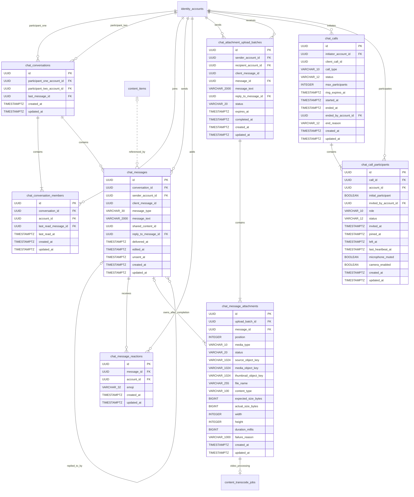

# Chat ER Diagram

This diagram reflects chat migrations through `V31__add_chat_media_attachments.sql`.

## Rules and constraints

| Table | Rule |
|---|---|
| `chat_conversations` | Participant UUIDs are stored in canonical order and must be different |
| `chat_conversations` | One conversation per participant pair |
| `chat_conversations` | `last_message_id` supports inbox ordering and preview hydration |
| `chat_conversation_members` | One member row per conversation/account pair |
| `chat_conversation_members` | `last_read_message_id` and `last_read_at` move forward monotonically |
| `chat_messages` | `(sender_account_id, client_message_id)` is unique for idempotent retries |
| `chat_messages` | `TEXT` requires text and rejects a shared-content reference |
| `chat_messages` | `CONTENT_SHARE` requires `shared_content_id`; text remains optional |
| `chat_messages` | `MEDIA` rejects `shared_content_id`; one or more attachment rows are enforced by the completion service |
| `chat_messages` | Replies reference a message in the same conversation at application level |
| `chat_messages` | Unsend sets `unsent_at`; the original payload remains stored but is hidden from API responses |
| `chat_message_reactions` | One replaceable emoji reaction per account/message |
| `chat_attachment_upload_batches` | `(sender_account_id, client_message_id)` is unique, making initiation and completion idempotent |
| `chat_attachment_upload_batches` | A completed batch must reference exactly one created media message and completion timestamp |
| `chat_message_attachments` | Position is unique per batch/message; private S3 object keys, not temporary URLs, are persisted |
| `chat_message_attachments` | Images become `READY`; videos transition `UPLOADING → PROCESSING → READY/FAILED` through the shared transcode queue |
| `chat_calls` | `(initiator_account_id, client_call_id)` is unique for idempotent start retries |
| `chat_calls` | Lifecycle timestamps/reason are constrained for `ACTIVE` and `ENDED` states |
| `chat_calls` | The persisted beta limit is 2–8 total participants |
| `chat_call_participants` | One row per account/call, retained through decline, leave, miss, or cancellation |
| `chat_call_participants` | `initial_participant` preserves the original idempotency payload when members are added later |
| `chat_call_participants` | `INVITED`/`JOINED` rows in ongoing calls determine busy state |

`shared_content_id` is intentionally an application-validated reference rather than a foreign key. This preserves an unavailable chat card if content is later physically deleted without preventing content or account cleanup. Preview hydration still requires a currently existing `PUBLISHED` post or reel, an active content owner, and viewer access.

Attachment S3 keys remain private. API responses generate expiring download URLs on demand, and the stable attachment UUID is the only frontend identifier. Abandoned pending batches are retained for 24 hours after URL expiry and then marked `EXPIRED` while their source objects are deleted best-effort.

## Read-state interpretation

Each participant has one monotonic read position per conversation. A message's `isRead` flag is true when the non-sending participant's `last_read_at` has reached that message. The inbox additionally exposes `hasUnread` when its last message was received by the current viewer and has not reached their read position.

`chat_messages.delivered_at` records recipient acknowledgement. Delivery status is derived as `SEEN` when the recipient read position reached the message, otherwise `DELIVERED` when `delivered_at` exists, otherwise `SENT`.

## Call-state interpretation

`chat_calls` stores lifecycle and history; media is not stored or proxied. `chat_call_participants` stores each member's invitation/join/leave state plus frontend-visible microphone/camera state and heartbeat. WebRTC SDP/ICE signaling remains ephemeral and is intentionally absent from the schema.

Calls are separate from `chat_conversations` because the current chat model is direct-only while calls may contain up to eight accounts. A later group-chat feature may add an optional conversation reference without changing call membership or signaling contracts.
