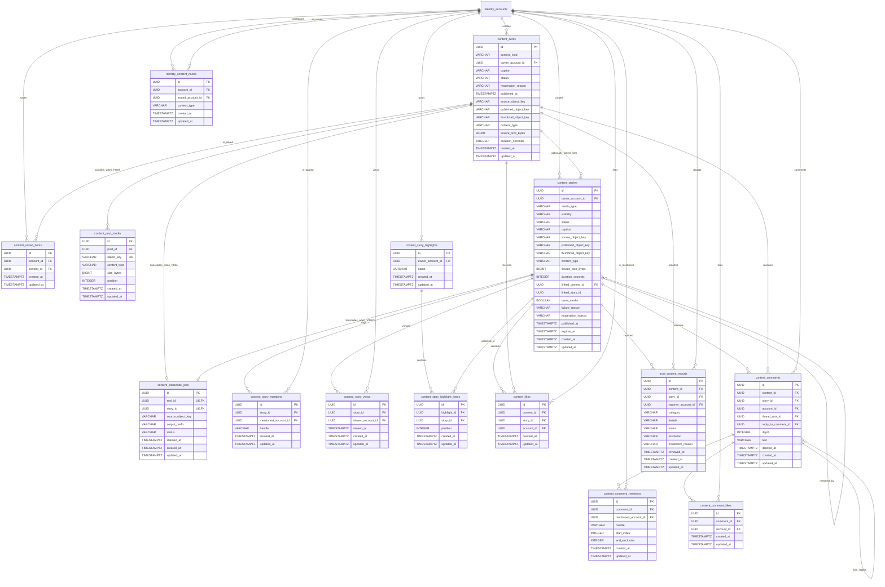

# Media, moderation, feed, and engagement ER diagram

`content_items.content_kind` is `POST` or `REEL`. Common ownership, caption, lifecycle, and publication fields live once in this table. Reel-only source/transcode columns are null for posts; post carousel images live in `content_post_media`.

The feed is query-based and has no table in the beta implementation. The unified home feed reads `PUBLISHED` rows from `content_items`, prioritizes the current account and followed accounts, and orders posts and reels together by `published_at` descending. Authenticated feed queries exclude creator/type pairs stored in `identity_content_mutes`; profile and direct-item reads are unchanged. The dedicated reels feed queries only `REEL` rows and applies `REEL` mutes when authenticated.

`content_saved_items` retains one save per account/content pair and never copies media. Posts and reels are queried into separate saved tabs in save-time order. Current visibility is applied when reading: the creator must be active, the content must remain `PUBLISHED`, and the creator must either be public or actively followed by the viewer. A private-content visibility change hides the row without deleting it, allowing the same saved item to reappear when the creator becomes public or the viewer follows again.

Users can like or comment on any visible story and any published post or reel, report permanent content or an active visible story, and like individual comments once per account. A like, comment, or report targets exactly one of `content_id` and `story_id`. Comment replies retain both their top-level thread root and exact reply target while rendering at depth one. Mention ranges use UTF-16 offsets and retain an account ID plus handle snapshot. Comment deletion is soft so existing reply threads remain readable; its likes are removed. Admin moderation can dismiss an individual report or take the target down; a takedown resolves every pending report for that target and removes it from feeds.

Stories are separate from permanent feed content. They may own one uploaded image/video or reuse the first image/published video of an owned post/reel. `expires_at` is exactly 24 hours after `published_at`; live feeds and direct story reads require `expires_at > now`, while the owner archive retains every `PUBLISHED` row and highlights can expose referenced expired rows again. Video stories share `content_transcode_jobs`; exactly one of `reel_id` and `story_id` is populated. Story tags retain an account ID and handle snapshot, while current profile summaries are returned to clients. A unique `(story_id, viewer_account_id)` view row makes `hasSeen` idempotent and supports the owner-only viewer list. Story feeds exclude `STORY`-muted creators, then sort unseen rows first and seen rows second, with each tier ordered by publication time descending.

Highlights are named collections owned by an account. `content_story_highlight_items` stores ordered references, so media is never duplicated and one story may appear in multiple collections. Each collection has unique story and position pairs. Creating or updating a highlight accepts only the owner's `PUBLISHED` stories, including expired stories; deleted, failed, taken-down, or unavailable link-only stories are rejected. Reads ignore story expiry but still apply profile privacy and the story's original `EVERYONE`, `FOLLOWERS`, or `CLOSE_FRIENDS` audience. Expired highlighted stories remain eligible for the existing engagement, viewer, and report operations while referenced by at least one highlight.
